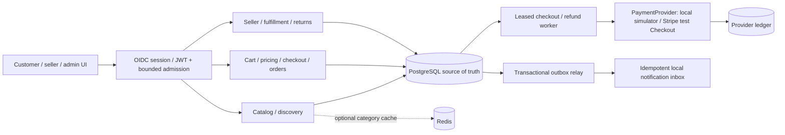
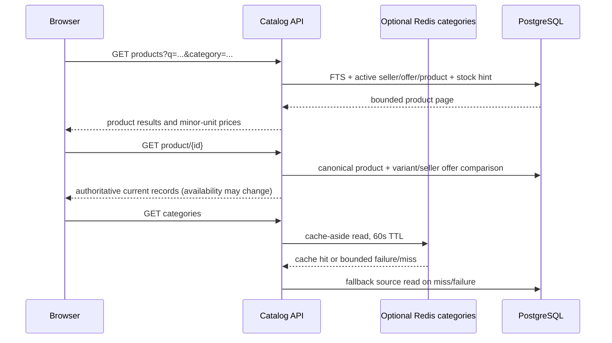

# Architecture and trade-offs

Java 21, Spring Boot 3.5.16, Spring MVC, Spring Security and JDBC form a modular monolith. JDBC makes conditional
reservation SQL and lock ownership visible; introducing JPA would not improve these invariants. Boot manages dependency
versions. Official compatibility: https://docs.spring.io/spring-boot/3.5/system-requirements.html. PostgreSQL 17 runs
Flyway migrations; Redis is an optional category cache, never a source of monetary or inventory truth. The minimal
frontend is same-origin HTML/JS served by Spring Boot, with no separate frontend deployment.

| Alternative                 | Consistency / latency                                 | Ownership / scaling                                    | Cost / operation                                              |
|-----------------------------|-------------------------------------------------------|--------------------------------------------------------|---------------------------------------------------------------|
| Modular monolith (selected) | Short local ACID transactions, simple lock boundaries | Package ownership, scale application replicas          | Low component count; shared DB bottleneck                     |
| Domain services             | Sagas and inboxes across databases, extra hops        | Independent ownership/scaling, smaller failure domains | Requires contracts, on-call and distributed reconciliation    |
| Global marketplace          | Home-region stock/order writes, local eventual browse | Regional ownership, residency and failover fencing     | Highest operational cost; replication is not distributed ACID |



Synchronous requests validate authentication/ownership, quote and reserve inventory, persist
order/payment/workflow/outbox in one transaction, and return PAYMENT_PENDING. Worker capture happens outside that
transaction. A second transaction commits inventory and confirms the order, or reserves a compensating refund if
cancelled/expired. Outbox/inbox is a local durable event pipeline; Kafka is intentionally not deployed. No exactly-once
delivery is claimed.

## Incremental extraction

First extract read-only search/indexing: PostgreSQL remains source; outbox envelopes carry id, schemaVersion,
aggregateId, aggregateVersion and correlationId. A Kafka relay must persist publication attempts and a DLQ; the local
relay does not yet implement this broker transport. Key by product/offer/order to order within one partition only;
consumers retain inbox IDs and compare aggregate versions. Rebuild versioned search index from a consistent DB snapshot
and replay the outbox watermark; switch alias only after catch-up. Revalidate product/offer/seller activity against
source before returning actionable offers and always at checkout. Never resurrect hidden items from stale documents.

Then extract notifications/carriers (already asynchronous boundaries), followed by inventory only when independent
scaling warrants loss of local atomicity. Introduce durable reservation commands and Saga compensation before splitting
databases. Stripe test Checkout now implements provider lookup/idempotency/timeouts; live-money/settlement adapters and
operational credential management remain separate work. Extracting catalog removes checkout share locks: offer versions
become contractual conditional acceptance tokens.

## Global extension

Start single-region multi-AZ PostgreSQL with durable storage and tested PITR. Regional read APIs use CDN/images and
replicated catalog/search; writes to stock, orders, payment routing stay in their home region. Active-passive DR needs
fenced old writers, measured replication lag, RPO/RTO drills and provider reconciliation before reopening checkout.
Active-active requires disjoint inventory ownership by seller/warehouse/region or consensus coordination; asynchronous
counters cannot prevent globally concurrent overselling. Cross-region orders orchestrate independently owned
reservations and may fail/compensate. Do not automatically replay ambiguous payment commands on failover without
provider lookup.

## Browse and cart request paths



```mermaid
sequenceDiagram
  participant C as Authenticated customer
  participant API as Cart API
  participant DB as PostgreSQL
  C->>API: POST cart/items (offerId, quantity) + CSRF
  API->>DB: ensure active customer, lock customer cart
  API->>DB: expire old cart if necessary, upsert owned item
  DB-->>API: durable cart state
  API-->>C: current cart, no inventory promise
  C->>API: POST checkout/quotes (owned address, coupon)
  API->>DB: validate cart and source prices; immutable snapshot
  API-->>C: five-minute quote
```

## Implemented authentication/payment extension

Shared PostgreSQL Spring Session replaces per-replica sessions. Browser OIDC login and stateless JWT API security have
independent filter chains. A test-mode Stripe adapter now uses hosted Checkout and provider-independent
polling/cancellation/refunds. Signed Stripe events are durably enqueued before acknowledgement; provider network IO
occurs outside webhook transactions. See production-auth-and-stripe.md for exact deployed-code semantics and
credential-dependent verification gaps.

## Kafka / logistics extension

Real Kafka transport now publishes the transactional outbox using a dedicated scheduler outside SQL transactions. A
PostgreSQL inbox protects notification effects before record offset acknowledgement; failed records go to a durable
DLT/replay workflow. Shippo rates/tracking and Stripe Tax calculations are HTTP ports with test-mode credentials, strict
monetary validation and explicit failure behavior. Quotation performs snapshot -> external IO -> snapshot
validation/persistence. Partial physical quantities and goods-tax refunds are tracked under order locks. Details and
tested guarantees: kafka-shipping-tax-and-quantities.md.

## Durable provider effect continuation

Label purchasing reserves order-line units independently from physical dispatch, commits a one-shot Shippo purchase
marker before external IO and reconciles ambiguous outcomes by metadata/provider ID. Tax recording inserts durable
sale/reversal jobs atomically with capture/refund state, uses original calculation/transaction IDs and finite
idempotency windows, and catches up historical records. Dedicated reporting scheduler isolates those external calls from
payment recovery/Kafka. See labels-and-tax-reporting.md.
