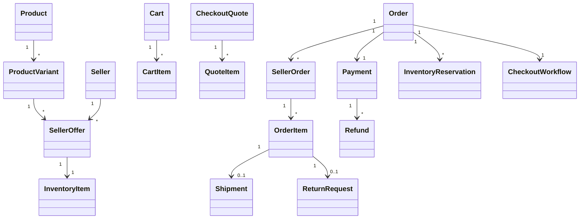

# Domain ownership and low-level model

| Context / package         | Aggregate and invariant                                     | Persistence / boundary                                                            |
|---------------------------|-------------------------------------------------------------|-----------------------------------------------------------------------------------|
| Identity / configuration  | OIDC subject, roles, local session + CSRF                   | OIDC browser login + shared JDBC session; stateless issuer/audience-validated JWT |
| Customer / catalog API    | Profile, owned address; active customer                     | customers, addresses                                                              |
| Seller / catalog API      | Seller approval and active ownership                        | sellers; audit_log                                                                |
| Catalog / catalog         | Product, variant canonical identity                         | products, product_variants, categories                                            |
| Offers / catalog          | One offer per seller/variant; positive INR price            | seller_offers                                                                     |
| Inventory / checkout      | on_hand >= reserved; one reservation transition             | inventory, inventory_reservations, inventory_movements                            |
| Cart / checkout           | 30 offers, quantity 1..100, owner-scoped                    | carts, cart_items; cart row lock                                                  |
| Pricing / checkout        | Exact minor units, HALF_UP aggregate discount               | promotions, quote_items, checkout_quotes                                          |
| Orders / checkout         | Quote one-use, customer idempotency; separate seller groups | orders, seller_orders, order_items                                                |
| Payments / payment        | Capture/refund provider keys and auditable references       | payments, attempts, webhook inbox, provider simulator ledger                      |
| Workflow / checkout       | Durable leased steps and bounded retries                    | checkout_workflows                                                                |
| Fulfillment / fulfillment | One shipment per full line; no cancelled shipping           | shipments; order lock                                                             |
| Returns / fulfillment     | One full-line return within 30 days of delivery             | returns, refunds; order lock                                                      |
| Reviews / catalog         | One review/customer/product after delivery                  | reviews; moderation updates derived aggregates                                    |
| Notifications / checkout  | Inbox deduplication by event/consumer                       | outbox_events, processed_events, notifications                                    |

Packages are pragmatic context groupings, not independently enforced module boundaries. Store centralizes JDBC/auth
helpers; API classes currently combine application service and REST orchestration. This is a deliberate baseline
simplification; splitting controllers/application services/ports and adding module dependency tests is necessary before
larger teams work independently. PaymentProvider is an external port; LocalPaymentProvider is a durable simulator and
StripeSandboxProvider is a real HTTP hosted test-checkout/refund adapter.

No giant Order object owns carrier or provider state. Cross-context coordination lives in Workflow; independent status
fields distinguish physical fulfillment from payment/refund state. Every order stores original unit price and allocated
line net. Quoted addresses live as JSON snapshots on checkout_quotes, linked permanently by orders. Public persistence
schema is Flyway V1; V2 is explicitly sandbox sample data. Immutable snapshot columns have no application update
endpoints, but DBA access is trusted; least-privilege DB roles/immutability triggers are not yet supplied.

Errors use RFC 9457 Problem Details for domain conflicts (409), invalid fields (400), missing/foreign resources (404),
roles (403), webhook auth (401) and bounded admission (429 + Retry-After). Spring Security supplies its own
authentication/CSRF responses. Money is stored as bigint minor units, INR only; unsupported currency conversion is
rejected by absence of such API. Pagination is bounded offset, not suitable for 100m SKUs; replace with cursor/keyset
pagination at scale.

Added bounded ports: ShippingProvider (Shippo/LocalShipping), TaxProvider (StripeTax/LocalTax), QuoteService (source
snapshot and monetary provider orchestration), EventService/KafkaEvents (outbox/notification consumer/DLT),
DeliveryService (quantity-guarded carrier delivery). Fulfillment supports multiple positive-quantity shipments and
returns per line, with exact goods+tax refund allocation.
