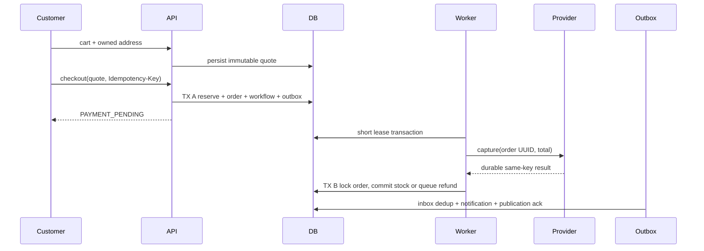
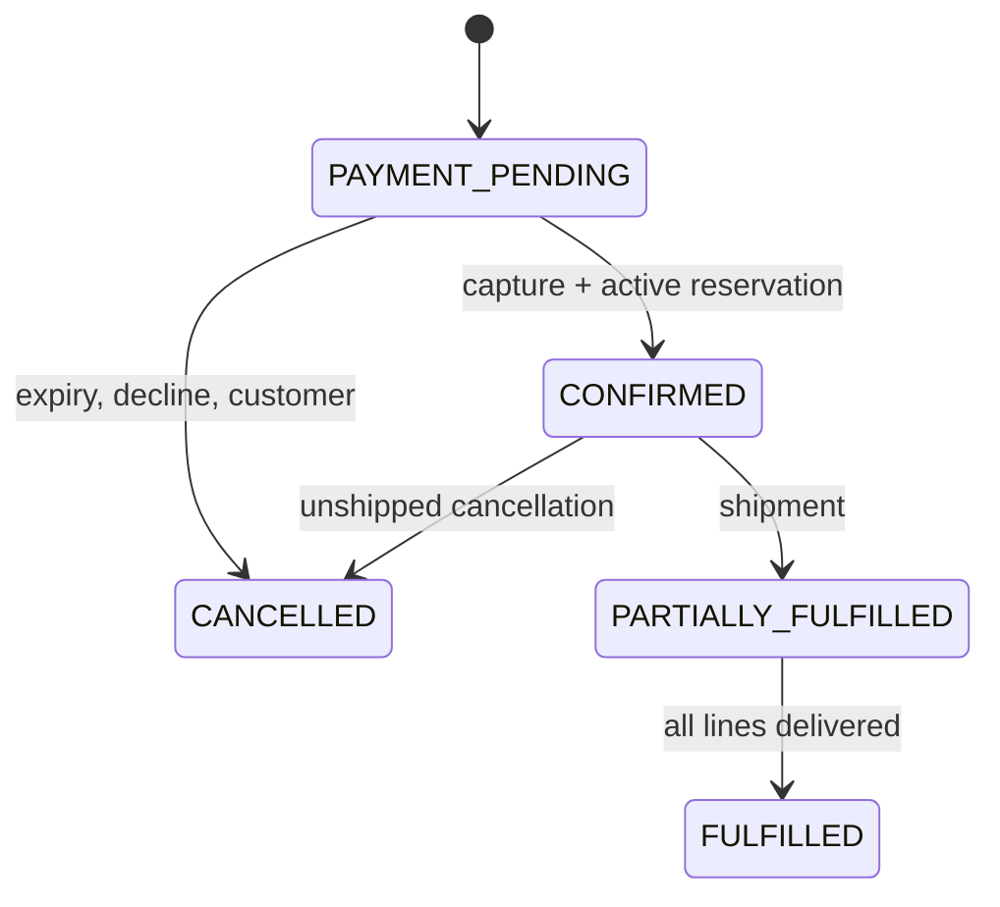

# Durable checkout orchestration

Quote: authenticated cart row lock; address ownership; current active seller/product/offer; integer pricing; optional
coupon eligibility; immutable five-minute snapshot. Checkout: cart row lock serializes same-customer idempotency; reject
key reused for a different quote; quote unique per order; seller/product/offer validation; conditional stock updates;
coupon usage increment and one redemption/customer; order, seller groups, payment, workflow and outbox commit together.
Price changes invalidate the quote rather than silently charge a different price.

Transaction A ends before payment. Worker claims a 30-second lease and increments attempts. Provider capture uses order
UUID as idempotency scope, persists an independent durable provider ledger entry, and returns a reference. Transaction B
locks order then payment, confirms payment, commits stock, confirms order and writes outbox. A duplicate leased worker
may execute; provider key and guarded local states prevent double effects. Eight attempts cause MANUAL_REVIEW, with
operator retry and audit. The simulator uses PostgreSQL for independent provider state; a real provider must honor these
semantics itself.

Cancellation locks the order, checks no shipment, changes order state and releases stock (pending) or restocks
previously committed physical stock (confirmed). A captured payment queues a full refund. A late in-flight capture after
cancellation is found by periodic reconciliation even if workflow was already marked DONE. Complete never reconfirms
CANCELLED. Refund execution has its own key, lease, bounded attempts and durable provider reference. There is no
distributed ACID transaction and compensation can remain pending.

Cart reads are synchronous hints; quotation and checkout are separate contracts. Cart changes after quotation do not
alter a quote. Coupons are consumed on successful order initiation and are not automatically returned on cancellation,
preventing cancellation abuse; administrative reversal policy is deferred. Same customer can use each coupon once,
globally limited by conditional update.

Discount allocation follows offer UUID order: floor(cumulative gross × order net / subtotal) minus prior cumulative net.
This conserves the exact total and keeps each line net between zero and its original gross, including tiny final lines.
Overall percentage discount uses HALF_UP minor units; cumulative allocation uses DOWN. No tax/promotion order is implied
beyond the one coupon implemented.
