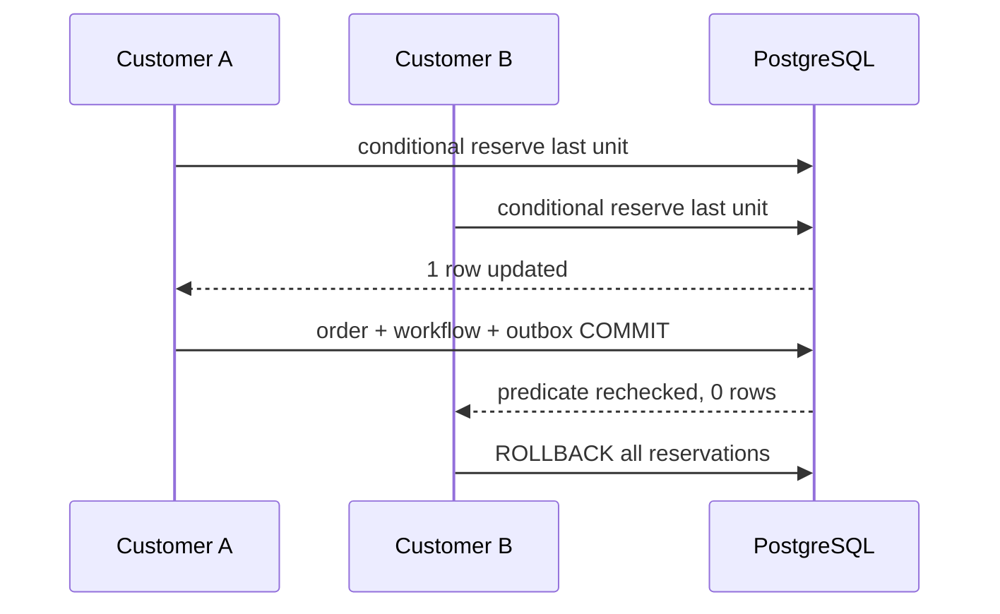
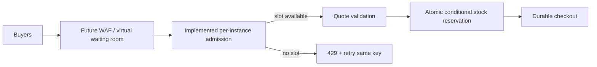

# Inventory accounting

Available-to-sell = on_hand - reserved. There is no second committed allocation counter. Reservation increments
reserved. Commit decrements both on_hand and reserved. Release only decrements reserved. Physical accepted return or
pre-shipment cancellation after commit increments on_hand exactly once. All transitions are transactionally paired with
reservation/order state and movement history.

```sql
UPDATE inventory SET reserved=reserved+:q,version=version+1
WHERE offer_id=:offer AND on_hand-reserved >= :q;
```

PostgreSQL READ COMMITTED rechecks the predicate after waiting for a concurrent updater. Exactly one of two last-unit
requests can update; zero affected rows fails the whole checkout transaction. All multi-offer stock locks follow offer
UUID order. Seller/product share locks prevent approval/moderation racing acceptance. Stock adjustments use a
conditional predicate and DB checks preventing on_hand below reserved. A deadlock/timeout rolls back the request; client
retries the same scoped checkout key. Pessimistic row locks are used on workflow/order transitions, not around external
network I/O. Optimistic version counters record changes but are not the primary concurrency mechanism. Redis counters
are explicitly non-authoritative. Serialized partitioned commands could reduce hot-row contention later, with more queue
latency and recovery burden.



Reservations share the order's 15-minute deadline. Worker expiry cancels pending order under the order lock and releases
ACTIVE reservations. A capture that crosses expiry is compensated with an asynchronous refund; it does not steal stock
now owned by another buyer. Commit/release serialize on the order. Worker outages can hold stock beyond 15 minutes until
workers resume; expiry is not a strict real-time guarantee. Eight failed attempts move workflow to manual review and
intentionally retain unresolved stock until an operator reconciles.

Flash-sale ingress is per-instance nonblocking semaphore (8 checkout slots), max 30 offers per cart, max 100 units/offer
and 16 DB connections. Requests above bounds receive 429 and retain no reservation. Database predicates remain final
authority. The in-process minute limiter (600 API requests/identity/IP) is not distributed fairness/bot protection; its
approximate bounded key map is insufficient for internet-scale adversarial abuse.



At 1m attempts/s, upstream capacity tokens and authenticated queue tickets are necessary; adding app replicas without a
DB connection budget increases overload. Admission grants permission to attempt, never stock entitlement. Stock tokens
require authoritative allocation, expiration fencing and reconciliation; this implementation does not claim them.
