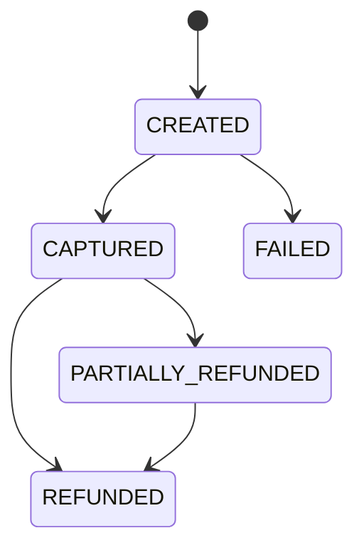
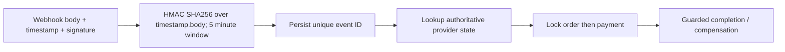
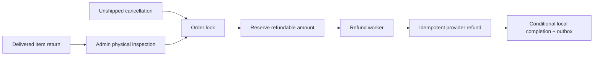

# Payment reliability

Current implementation: [production authentication and Stripe contract](production-auth-and-stripe.md). Both the local
durable simulator and real HTTP Stripe test adapter implement PaymentProvider. Workflow polling and cancellation no
longer query simulator ledger tables. Hosted Stripe payment is PENDING until provider-confirmed payment, with
checkout_url available only through owned payment/order responses. Live-money keys are rejected.

A provider FAILED record releases pending stock and cancels checkout. Ambiguous outcomes remain READY until retries
exhaust, then manual review. Never issue a new capture key to resolve ambiguity. Provider operation rows are immutable
by application APIs except cumulative refund amount. Payment attempts preserve capture references; refund rows preserve
refund references. Ledger is auditable operational state, not double-entry settlement/payout accounting.

`X-Signature` is lowercase/uppercase hex HMAC-SHA256 of raw UTF-8 `X-Timestamp + '.' + raw body`; replay window 300
seconds. Body: `{ "eventId":"evt-1", "paymentId":"uuid", "status":"CAPTURED" }`. Authenticated contradictory
FAILED/REFUNDED hints do not regress CAPTURED; provider lookup determines truth. Failed processing rolls back dedup
entry so redelivery may retry. Unknown provider refs cannot confirm payments. This signature format is a local simulator
contract, not Stripe/Razorpay's format.

Refund reservations sum *all* refund rows, including pending/manual/completed, under order/payment locks. This prevents
both duplicate keys and concurrent distinct refunds exceeding captured amount. Provider repeats a refund key only for
the same payment/amount. Local finalize is conditional so duplicate completion does not double count. Return refunds use
discounted line net, with deterministic allocation ensuring sum equals paid order total. Inspection is a one-time state
transition; only accepted physical condition restocks.

Reconciler runs every 60 seconds and detects provider capture with local CREATED, and cancelled CAPTURED orders lacking
refund. It repairs those bounded batches. It does not yet reconcile externally initiated refunds, disputes, chargebacks
or settlement. Stripe webhooks now have their own durable async inbox; the timestamp.body simulator signature described
above is only for /webhooks/local, while /webhooks/stripe uses Stripe-Signature t/v1 verification. See the current
contract linked above. Manual intervention is essential for unresolved outcomes. See runbook for SQL checks; no PCI-DSS
or regulatory compliance claim is made.
