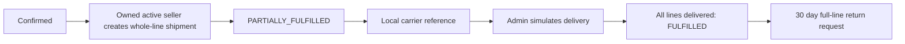

# Operations

## Local launch and restore

`cp .env.example .env` and change local values. `docker compose up -d --build`. Open http://localhost:8097. Users
customer/customer2, seller/seller2 and admin share the configured LOCAL_PASSWORD. Never expose these fixtures.
`docker compose logs -f app`. Stop with `docker compose down`; retain PostgreSQL volume unless deliberately destroying
sandbox data with `down -v`. Back up before migration; Flyway schema validation is automatic. Restore into an isolated
database, validate counts/invariants and reconcile provider before routing writes. Actual PITR/multi-AZ/failover drills
remain unverified.

Readiness/liveness: `/actuator/health/readiness`, `/actuator/health/liveness`. Readiness includes PostgreSQL health;
Redis is excluded because it has safe fallback. DB outages also return request errors. Prometheus is
`/actuator/prometheus` with ADMIN authentication; form session cookie required locally. Import monitoring/dashboard.json
into Grafana and provision monitoring/alerts.yml in Prometheus. Configure http.server.requests histogram and OTLP
exporter endpoint using Spring/OTEL configuration. No monitoring server is launched automatically.

## Payment mismatch / stuck checkout

1. Inspect `/api/v1/admin/status` and workflow `attempts`, `last_error`, `next_attempt`, `status`.
2. Query order and local payment, then look up provider by exact order key. Never choose a new financial key or manually
   mark paid without evidence.
3. If provider captured and order pending, normal reconciliation invokes complete; if cancelled it queues refund. Retry
   MANUAL_REVIEW via `POST /api/v1/admin/workflows/{orderId}/retry` after diagnosis. The stable key is retained.
4. Compare provider total/currency/reference, local amount/refunded and pending refunds. Contradictory external
   settlement/chargeback requires an additional reconciliation/operator workflow, not present here.
5. Eight failed attempts require manual handling; no automatic infinite retries. Reservations can remain held during
   manual review. Inform customer of unresolved status.

## Refunds

Check refunds status/attempts/provider_ref and provider_refunds.operation_key before retry.
`POST /api/v1/admin/refunds/{id}/retry` reuses the original key. All pending/manual/completed refund rows reserve their
eligible amount. Never delete an ambiguous pending refund to free budget. Each physical return quantity is inspected
once and restocked only if accepted condition warrants it. Partial refunds include allocated goods tax;
shipping/tax-on-shipping follow the nonrefundable delivered-order policy. Provider failure does not undo physical
receipt; refund may remain pending.

## Inventory / overselling

```sql
select *
from inventory
where reserved < 0
   or on_hand < reserved;
select i.offer_id, i.reserved, coalesce(sum(r.quantity) filter(where r.status='ACTIVE'), 0) active
from inventory i
         left join inventory_reservations r on r.offer_id = i.offer_id
group by i.offer_id
having i.reserved <> coalesce(sum(r.quantity) filter(where r.status='ACTIVE'), 0);
select o.id, o.total, sum(i.net) + q.shipping + q.tax expected
from orders o
         join order_items i on i.order_id = o.id
         join checkout_quotes q on q.id = o.quote_id
group by o.id, q.id
having o.total <> sum(i.net) + q.shipping + q.tax;
```

These should return no rows. On violation stop checkout ingress, preserve audit/movement history, compare physical
warehouse quantities, find offending mutation path, reconcile with approved adjustments. Do not reset counters blindly.
Inspect PostgreSQL pg_stat_activity/pg_locks for lock wait/transaction age, Hikari pending connections and request
rejection. Keep connection budget across replicas below DB tested capacity. Shed load before increasing pools.

## Queue/outbox and provider outage

Outbox local relay locks bounded batches with SKIP LOCKED and commits notification inbox + published marker together.
Duplicate relay does not duplicate notifications. Replay in sandbox by resetting published_at for selected events; inbox
prevents duplicate effects. External Kafka transport, DLQ and poison-event quarantine are not implemented; if adding
them use publication retry backoff and separate consumer inbox, never assume publish+ack atomic across broker/DB.
Notification outage must not roll back confirmed orders.

Provider outage leaves workflow READY, then MANUAL_REVIEW; do not abandon ambiguity. Redis outage falls back to DB
categories, with 200ms timeout; Redis contains no carts, prices or stock authority. PostgreSQL failure stops writes; no
Redis-based checkout fallback. Region loss fences old DB/application writers, restores owned partitions, checks
replication RPO and provider state, then reopens writes. No automatic cross-region financial replay.

## Fulfillment



Seller suspension prevents new selling/fulfillment; an operator must decide to restore seller or resolve unshipped
orders. Existing physical shipments can receive simulated delivery. No real carrier reconciliation or seller payout
workflow exists. Rolling upgrades must preserve event schema version 1 readers; deploy additive schema changes first,
then new writers, then remove old reads only after retention/replay window. Never change state enum semantics in place.

## Shared sessions and Stripe recovery

See production-auth-and-stripe.md for runnable overlays and IdP/Stripe secret configuration. Session tables are
Flyway-managed and shared by replicas. Revoke all sessions with authenticated DELETE /api/v1/sessions (CSRF for
browsers); disable a subject via the admin customer deactivation API. IdP role revocation must be paired with session
revocation/deactivation for immediate effect.

Inspect stripe_operations before any manual payment retry. Do not delete ambiguous operations or change keys. Unknown
POSTs beyond 23h fail closed. Provider IDs recovered from signed matching webhooks allow safe retrieval. Stripe refund
status pending remains locally PENDING and consumes refundable budget; only succeeded finalizes it. Admin payment-events
list/retry endpoints expose durable webhook failures. Redelivery can be acknowledged before processing because inbox
commits atomically; workers/reconciliation recover later. Never use the simulator webhook secret for Stripe events.

## Kafka / carrier / tax operations

Use kafka-shipping-tax-and-quantities.md for the implemented transport and provider runbook. Outbox publication is now
on a scheduler isolated from financial recovery; broker failure retains original IDs in READY/MANUAL_REVIEW. Inspect
/admin/events/failures for DLTs and retry only after repairing the cause. No broker/DB distributed atomic transaction is
assumed. Use /admin/shipments/{id}/retry-tracking to resume bounded carrier polling. Quote provider outages return
sanitized503 and preserve the cart; no order/inventory reservation is created. Never configure a zero-tax/free-shipping
fallback for a failing real provider.

## Label and tax transaction recovery

See labels-and-tax-reporting.md for implemented endpoints and guarantees. Never reset purchase_started_at or reissue a
Shippo purchase because a response was lost. Inspect original operation metadata/rate/provider ID; retry means
reconcile, not buy again. Admin pre-purchase abort and verified ERROR/REFUNDED release are supported;
ambiguous/dispatched quantity cannot be freed.

Stripe Tax jobs retain original keys, request snapshots and finite retry windows. A reversal waits for a recorded
original sale and completed customer refund. Provider IDs are persisted before local finalization. Use validated GET
attachment for old ambiguity; do not choose a new reference. Legacy partial refunds with unknown tax splits must be
reconciled manually without repricing customer refunds. V6 catch-up finds unreported historical captured/refunded
records in bounded batches.
